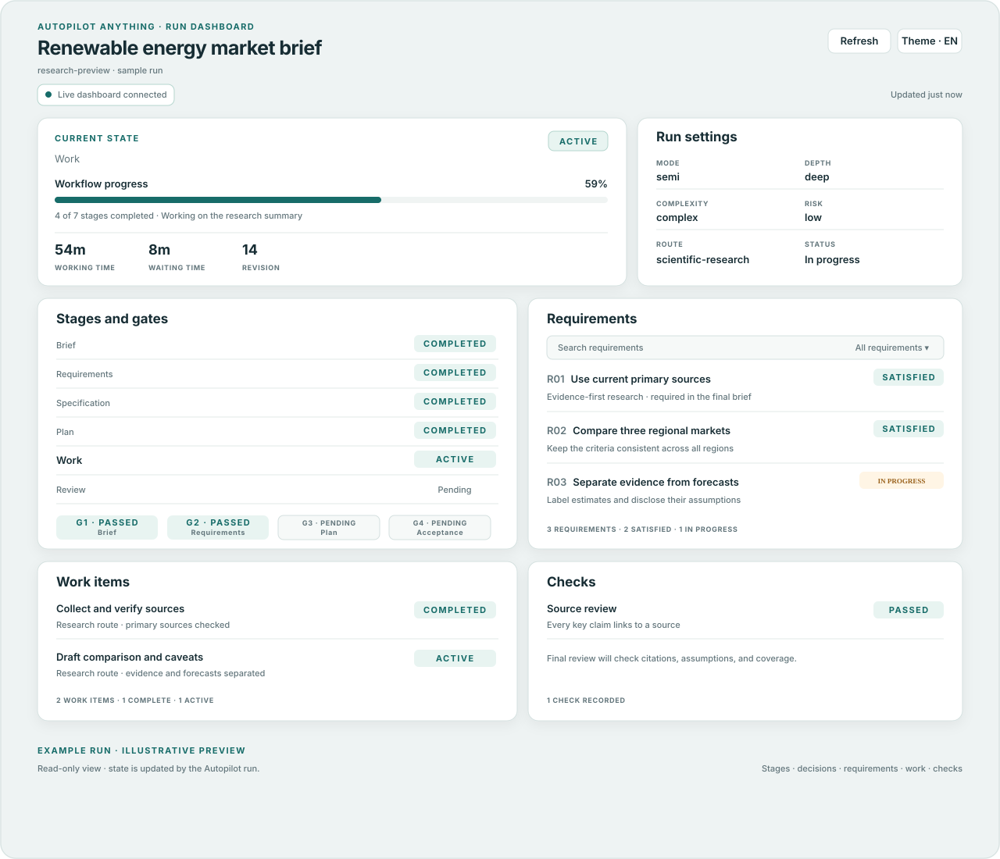

<p align="center">
  
</p>

<p align="center"><strong>One skill. Any task. A checked result.</strong><br>
Take a rough request through the right amount of discovery, planning, work, and review.</p>

<p align="center"><strong>English</strong> · <a href="README.ru.md">Русский</a></p>

<p align="center">
  <a href="https://github.com/atrshncv-ai/autopilot-anything/actions/workflows/validate.yml"></a>
  <a href="LICENSE"></a>
</p>

<p align="center"><a href="references/dashboard.md"></a></p>

Autopilot Anything is a portable agent skill for requests that range from a quick file edit to a complex, multi-step project. It finds the missing details that could change the outcome, then adapts the workflow and checks to the task.

## Quick start · Codex

Install it for your Codex account:

```sh
SKILLS_DIR="${CODEX_HOME:-$HOME/.codex}/skills"
mkdir -p "$SKILLS_DIR"
git clone https://github.com/atrshncv-ai/autopilot-anything.git "$SKILLS_DIR/autopilot-anything"
```

Restart Codex if it was already open, then ask for work with the skill:

```text
$autopilot-anything Create a 6-slide presentation comparing three options for my project.
```

Codex can also select it from `/skills`. For Claude Code and Cursor, install it in their user skill directory and invoke `/autopilot-anything`; see the [platform guides](#install-on-other-agents).

## What it can handle

| Route | Example request | Result-specific checks |
|---|---|---|
| Code and software | Build a small app or fix a feature | Run the relevant project checks and review the change |
| Scientific research | Examine a hypothesis and write a paper draft | Verify sources, separate evidence from inference, and disclose limits |
| Information gathering | Compare products, policies, or current events | Check current sources and link claims to evidence |
| Data analysis | Find drivers in a dataset or build a chart | Preserve inputs, explain methods, and make calculations reproducible |
| Presentations | Create a deck for a specific audience | Inspect the rendered slides for content and layout |
| Documents and files | Prepare a report, spreadsheet, or project files | Check the content and the output format; render when layout matters |
| Anything else | Plan a trip, organize a process, or work through a decision | Use available tools, state assumptions, and verify what can be checked |

## One workflow, right-sized for the task

The skill keeps the original brief, a requirement ledger, progress and a resume point, and final acceptance against what you asked for. Simple, low-risk requests can go straight to the result. Larger or riskier work gets a deeper interview, a plan, and checks suited to its deliverables. It searches for missing requirements, asks about the ones that could change the outcome, and can continue an interrupted run.

Each run has a live, read-only progress dashboard when the host supports it, plus a standalone HTML snapshot. The dashboard shows stages, decisions, requirements, work items, checks, and recent activity; it does not control or approve the work. [See the dashboard lifecycle](references/dashboard.md).

## Install on other agents

This repository is the complete skill folder. Keep `SKILL.md`, `references/`, and `scripts/` together.

| Agent | Invoke | Guide |
|---|---|---|
| Codex | `$autopilot-anything` or select it in `/skills` | [Install, update, and verify](platforms/codex.md) |
| Claude Code | `/autopilot-anything` | [Install, update, and verify](platforms/claude-code.md) |
| Cursor | Choose `autopilot-anything` from the Agent `/` menu | [Install, update, and verify](platforms/cursor.md) |

The Codex package has a dedicated setup guide. Claude Code and Cursor have documented installation instructions, but have not been runtime-tested here. Other agents may be able to use the portable `SKILL.md` and references with best-effort behavior.

## Compatibility status

| Platform | Verified here |
|---|---|
| Codex | Install and native skill discovery observed with CLI 0.142.5 on 2026-10-21. Behavioral checks remain pending: inference stopped before a response because the available model IDs were rejected. [Full record](compatibility/codex.md). |
| Claude Code | Install guide follows the documented skill mechanism; runtime checks not run. |
| Cursor | Install guide follows the documented skill mechanism; runtime checks not run. |

These results describe the observed environment, not a guarantee for every version, account, or setup. A package validation pass does not count as a platform runtime check.

## Tools, risk, and evidence

The package provides instructions, references, a progress tracker, and a package validator. It does not provide a browser, file editor, connector, credentials, or other execution service; actual capabilities depend on the tools and permissions available in the agent's environment. The skill can prepare plans and recommendations for physical tasks, but does not claim to perform physical steps. In high-risk areas it can offer evidence-based guidance with uncertainty and appropriate boundaries. Sending, publishing, paying, purchasing, deleting, and other consequential external actions require confirmation.

## For contributors

- [Package architecture map](docs/architecture.md)
- [Context and project conventions](CONTEXT.md)
- [Architecture decisions](docs/adr/0001-standalone-public-package.md)
- [Changelog](CHANGELOG.md)
- [Platform compatibility records and scenarios](compatibility/README.md)
- [Shared workflow](references/core-workflow.md)
- [Package validation](scripts/validate_package.py)

Run the package checks from this directory:

```sh
python3 scripts/validate_package.py
python3 -m unittest discover -s tests -p 'test_*.py'
```

GitHub Actions runs the same checks on pushes and pull requests.

## License and attribution

Distributed under the [MIT License](LICENSE). This adaptation is based on Nick Vels's Autopilot skill in the [nick-vels/skills](https://github.com/nick-vels/skills) collection. See [ATTRIBUTION.md](ATTRIBUTION.md) for attribution and scope.
